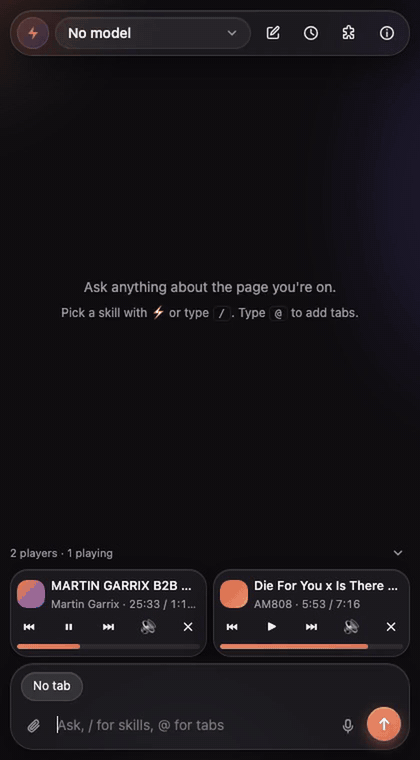
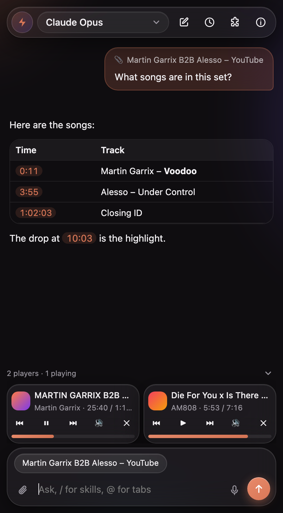
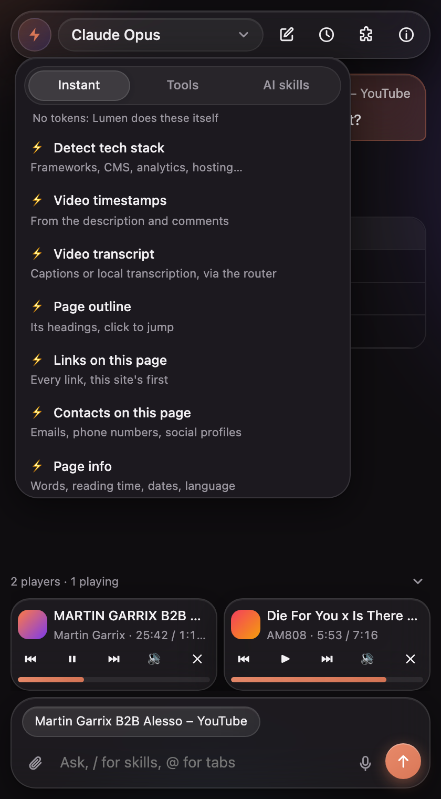
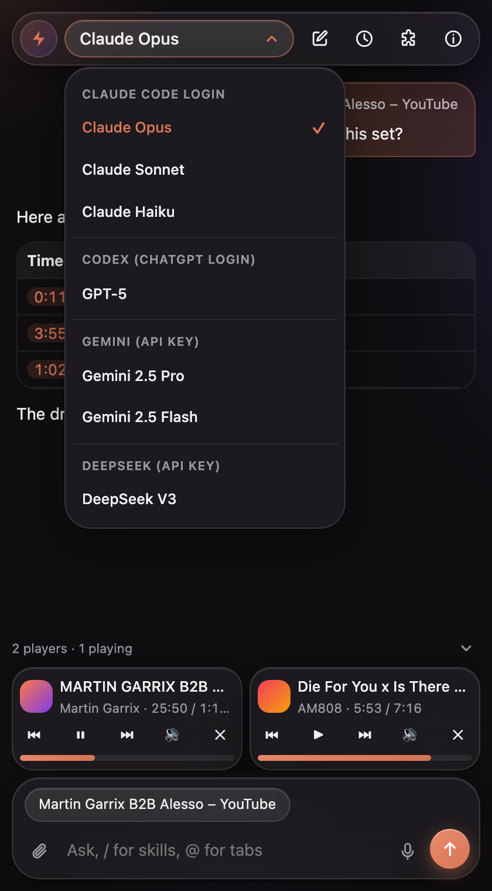
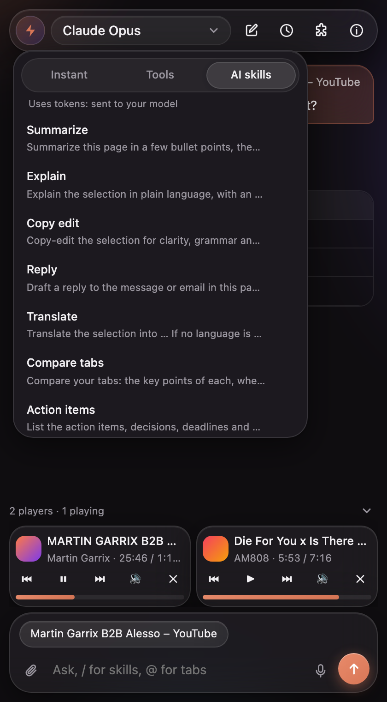

<div align="center">

# ✦ Lumen

**Your own AI in the browser sidebar.** Pick the model, sign in with the login you already have.

Built to replace Dia's chat · works in Chrome, Arc, Brave and Edge · macOS



<sub>[▶ Watch in full quality (MP4)](docs/media/demo.mp4)</sub>

</div>

## Install in one line

```bash
curl -fsSL https://raw.githubusercontent.com/MarcusLai07/lumen/main/install.sh | bash
```

It downloads Lumen to `~/Lumen`, sets up the small local router, copies the extension's folder path to your clipboard and opens your browser's extensions page. Then:

1. Turn on **Developer mode** (top right).
2. Click **Load unpacked** → press **⌘⇧G** → **⌘V** → Return → **Select**.
3. Pin Lumen from the 🧩 menu and click it.

That's it. **Update:** run the same line again, then click ↻ on Lumen in the extensions page.

<details>
<summary><b>Options, uninstall, and what it installs</b></summary>

<br>

| | |
|---|---|
| Needs | macOS, Node.js 18+ (the installer offers `brew install node` if it's missing) |
| Pull requests | uses your `gh` logins if the GitHub CLI is installed (`brew install gh && gh auth login`) |
| Video tools | asks before installing `yt-dlp` + `ffmpeg` (≈0.5 GB). Skip the question with `--with-video` or `--no-video` |
| Somewhere else | `--dir ~/Apps/Lumen` |
| Uninstall | `curl -fsSL …/install.sh \| bash -s -- --uninstall` then remove Lumen from the extensions page |
| From a clone | `git clone https://github.com/MarcusLai07/lumen && ./lumen/install.sh` |

Flags go after `bash -s --` when piped, e.g. `… | bash -s -- --with-video`.

The router is copied to `~/Library/Application Support/lumen/` (macOS won't let a browser start programs inside `~/Documents`), and registered with Dia, Chrome, Arc, Brave, Edge and Chromium. API keys live in `~/.config/lumen/config.json`, readable only by you. Logs: `~/Library/Logs/lumen/host.log`.

**Why the manual click?** Browsers only let you add an extension outside their store through *Load unpacked*. No script is allowed to do it for you.

</details>

## Connect a model

Open Lumen's **ⓘ** screen. Use a login you already have, or paste an API key.

| | Use your login (no key) | Or an API key |
|---|---|---|
| **Claude** | [Claude Code](https://claude.com/claude-code): run `claude` once to sign in | Anthropic |
| **OpenAI** | [Codex CLI](https://github.com/openai/codex): `npm i -g @openai/codex && codex login` | OpenAI |
| **Gemini** | [Gemini CLI](https://github.com/google-gemini/gemini-cli): `npm i -g @google/gemini-cli`, run `gemini` | Gemini |
| **DeepSeek** | – | DeepSeek |

Installed a CLI after Lumen? Run the install line again so the router finds it.

## What it does

<table>
<tr>
<td width="50%" valign="top">

<b>Chat about your tabs.</b> The page you're on and any highlighted text go along. Type <code>@</code> for other tabs. Times like <code>3:55</code> in answers jump the video.
</td>
<td width="50%" valign="top">

<b>Instant actions, zero tokens.</b> Tech stack, video timestamps and transcripts, page outline, links, contacts, page info: worked out on your Mac, no AI.
</td>
</tr>
<tr>
<td valign="top">

<b>Any model, mid-chat.</b> Claude, GPT, Gemini, DeepSeek. Switch whenever; the chat carries over.
</td>
<td valign="top">

<b>Skills.</b> Summarize, Explain, Translate, Compare tabs… or write your own. Type <code>/</code>, drag to reorder, edit or delete any of them.
</td>
</tr>
</table>

<details>
<summary><b>Everything else</b></summary>

<br>

- **Media strip:** a mini player for every tab playing audio or video: play, skip, seek, mute, jump to it. Live streams (YouTube Live, Twitch, sports) get a **LIVE** tag; fall behind and **Go live** jumps back to now.
- **Save images & videos** from a page at full size, into `Downloads/Lumen/<site>/`.
- **Pull requests**, like Arc's live folders: your open PRs from every `gh` account (review requested, yours, assigned) with CI and review status, checked every 3 minutes. New review requests can notify you and open in a "PRs" tab group, and those tabs close once the PR is merged. Merged and closed PRs notify you too and stay listed until you mark them read; the PR button counts everything waiting. On a PR page, ⚡ → Instant has its checks, a re-run of failed jobs, the full diff for follow-up questions, and the branch name. Needs the [GitHub CLI](https://cli.github.com) signed in (`gh auth login`).
- **Tidy tabs** (⚡ → Tools), worked out on your Mac with no AI and no tokens: sort loose tabs into named, colored groups by topic, group them by site, or close duplicates. Pinned and grouped tabs, mail, calendar and chat stay put, and every action can be undone. Choose Broad, Balanced or Specific groups in ⓘ. **Off in Dia:** Dia shows extensions every Space as one window, so tidying would move tabs between your Spaces.
- **Extensions manager** (🧩): every extension with on/off switches, options and remove.
- **Attachments:** images, PDFs, text, a screenshot of the tab, or a recent download.
- **Read-only browsing:** when it needs more, the AI can read your tabs and open links in the background. It never clicks or types, and asks before visiting links that came from nowhere. Allow one page and the rest of that site opens without asking for the rest of the chat; sites you name yourself never ask.
- **Saved chats:** searchable history; edit a question or regenerate an answer.
- **Right-click → Lumen** on text or images, and `ai` + space in the address bar.
- **Voice input**, light and dark glass themes, and motion that turns off with *Reduce motion*.

</details>

<details>
<summary><b>Timestamps for any YouTube video</b></summary>

<br>

No chapters and no timestamped comments? Lumen gets a transcript through the router, cached in `~/Library/Caches/lumen/transcripts`:

1. YouTube's captions via [yt-dlp](https://github.com/yt-dlp/yt-dlp), in about 10 seconds;
2. otherwise it transcribes the audio on your Mac with [Parakeet](https://github.com/senstella/parakeet-mlx) or [whisper.cpp](https://github.com/ggml-org/whisper.cpp);
3. with a Gemini key, Gemini can watch the video (it hears music, handy for DJ sets).

```bash
brew install yt-dlp ffmpeg whisper.cpp
uv tool install parakeet-mlx   # optional, faster for English and European audio
```

The first local transcription downloads a model (1.6 GB whisper, 2.5 GB Parakeet; set `LUMEN_WHISPER_MODEL=ggml-small.bin` before installing for a smaller one).

</details>

<details>
<summary><b>Dia: open Lumen with ⌘E</b></summary>

<br>

In Dia → Settings → Shortcuts, move **Chat…** (⌘E) and **New Chat** (⇧⌘E) to other keys. Then set ⌘E for Lumen in `dia://extensions/shortcuts`.

</details>

## Privacy

Everything runs on your machine. Your questions go only to the provider you pick. Chats are stored in the browser, keys in a file only you can read, and the router only answers Lumen's own extension ID.

<details>
<summary><b>How it works (for developers)</b></summary>

<br>

```
Side panel (extension/)  ──native messaging──▶  host/router.js  ──▶  providers/*.js
                                                                    ├─ claude-cli / codex-cli / gemini-cli
                                                                    ├─ anthropic-api
                                                                    └─ openai-compatible: OpenAI, Gemini, DeepSeek
```

- The panel (`extension/panel/`) owns the conversation and keeps chats in IndexedDB. API providers get the history with each request; CLI providers resume their own session.
- CLIs run in an empty folder with tools off, so they only chat. Browsing tools (`host/providers/tools.js`) run in the panel; Claude Code reaches them through a small MCP server over a Unix socket.
- The media strip (`extension/media.js`) needs no router. Add a site's skip buttons to `ADAPTERS`.
- New provider: add a file in `host/providers/` and register it in `host/providers/index.js`.

Dev tools:

```bash
node dev/serve.js                                   # the panel at /extension/sidepanel.html?harness, with fake APIs
node host/test-host.js "hello" claude-cli haiku     # the router, without a browser
CHROME=/path/to/chrome-headless-shell node dev/capture.mjs   # re-record the screenshots and demo
```

Upgrading from BYO Sidebar? Run the installer: it moves your keys and caches, and saved chats carry over.

</details>

<sub>Not affiliated with The Browser Company or Dia. MIT licensed. Motion by [anime.js](https://animejs.com) (MIT).</sub>
